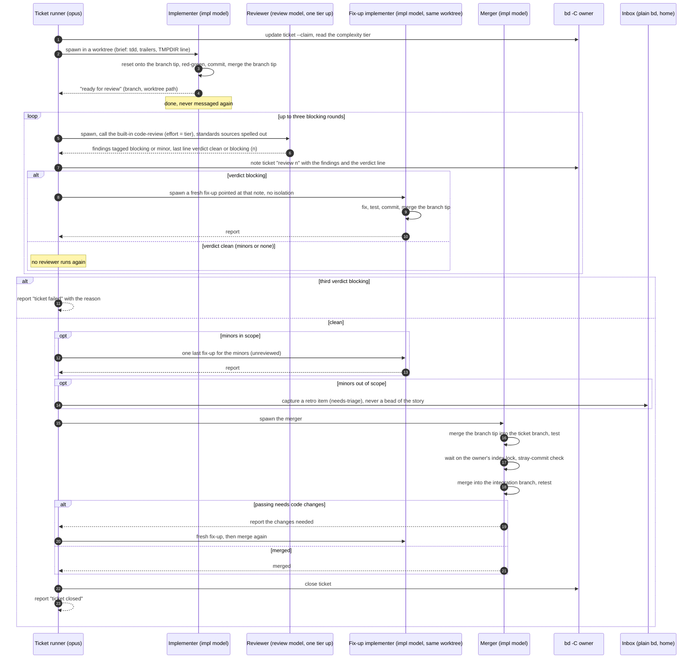
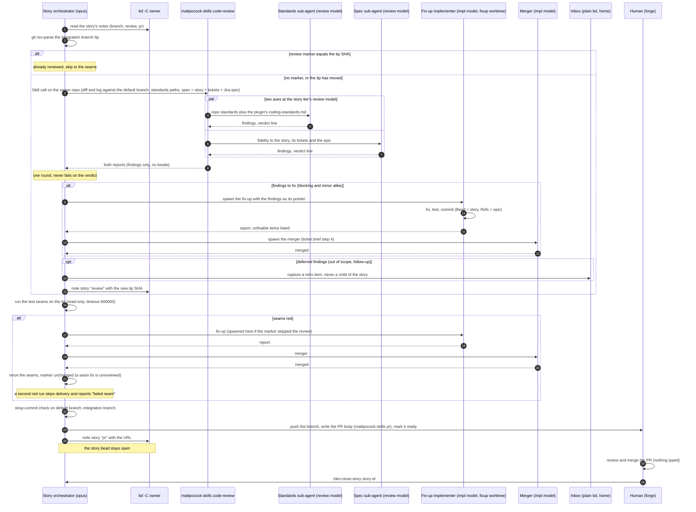

# Review stages (sequence diagrams)

How a change is reviewed on its way from a ticket to a merged PR, drawn as two sequence
diagrams. This page explains; it decides nothing. The rules it draws are in
`docs/agents/orchestration.md` (Complexity tier, Review), the ticket runner brief and step
7 of `skills/implement-story/SKILL.md`, and the why in `docs/adr/0001-two-stage-review.md`.
When the diagrams and those texts disagree, the texts win and the diagram is the bug. Bold
terms are defined in `GLOSSARY.md`.

Two review tools, two stages: per ticket, the built-in `code-review` (a bug hunt at effort
`medium` or `high`, matching the tier) run by a reviewer at the tier's review model; per
story, `mattpocock-skills:code-review` (repo standards and fidelity to the spec), its two
sub-agents at the story tier's review model. Never write the review skill bare in a doc:
four skills answer to that name.

## Stage 1: per-ticket review

Runner brief steps 2 to 5, for `medium` and `high` tickets. A `low` ticket has no
reviewer: its implementer reports, and the **ticket runner** goes straight to the merger.

## Stage 2: story review and delivery

Steps 7 and 8 of `/dev:implement-story`, then the human on the forge (the runbook's
stage 5).

## Three rules the diagrams encode

- **One tier up, always.** The reviewer runs at the review model of the ticket's or
  story's tier, never at the implementer's. That is why the runner spawns the reviewer
  instead of letting the implementer call the skill (ADR 0001).
- **Fresh fix-up, same worktree.** Findings never go back to the first implementer by
  message. Each round spawns a new **fix-up implementer** in the worktree the implementer
  left behind (the rules doc's Orchestrator role).
- **Only blocking rounds count.** A clean round with minors ends the review loop. The
  minors get one unreviewed fix-up or go to the inbox as a **deferred finding**, and the story
  tier never fails on a verdict at all (the rules doc's Review verdict).
