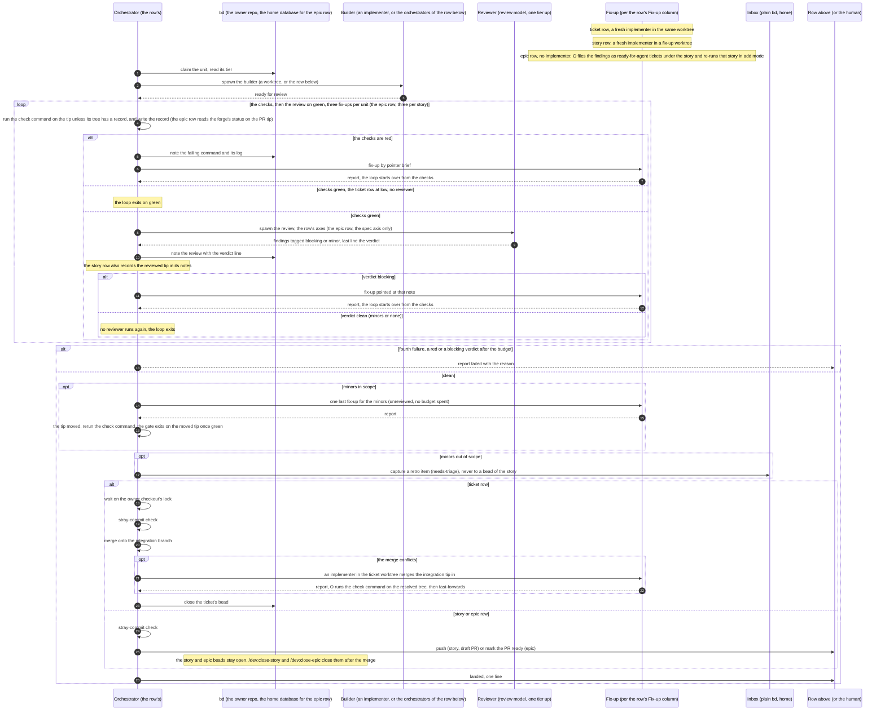

# Sequence diagram

How a feature is implemented, drawn once: the loop every row runs. This page explains and
decides nothing. The rules are in `docs/agents/orchestration.md`: the loop and its table
(The loop), the two scoping rules (Scoping rules), the six trust rules (Trust rules), the
check gate and the review verdict (Review) and the frontier (Frontier). The why is in
`docs/adr/0014-one-loop-at-three-rows.md`, ADR 0006 and ADR 0011. When the diagram and those
texts disagree, the texts win and the diagram is the bug. Bold terms are defined in
`GLOSSARY.md`.

## The loop

The ticket, the story and the epic are one loop at three rows. The diagram draws the row
in general, with `O` the row's orchestrator and the unit a ticket, a story or an epic. Each
row's parameters are the model doc's table (`docs/agents/orchestration.md`, The loop): the
Fix-up column is where the rows differ most, and the diagram draws all three of its cases.

