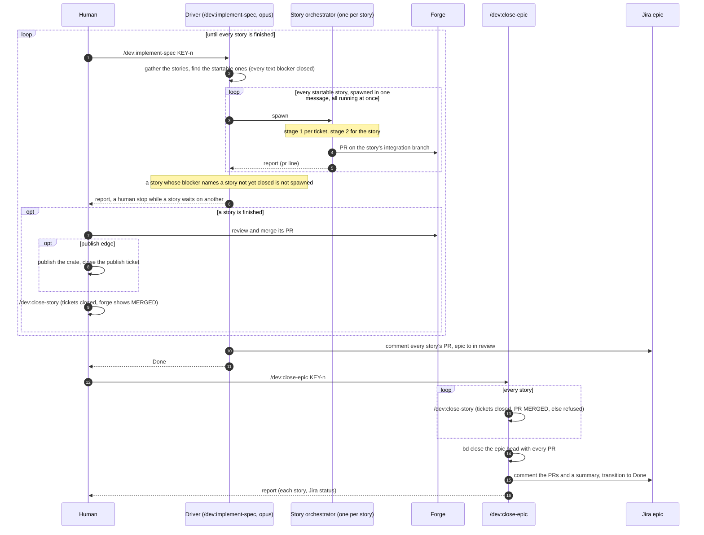

# Sequence diagrams

How a feature is implemented, from the runbook's `/dev:implement-spec` to `/dev:close-epic`,
drawn as three sequence diagrams: the ticket, the story and the epic. This page explains; it
decides nothing. The rules it draws are in `docs/agents/orchestration.md` (Complexity tier,
Review, Frontier), the ticket runner brief and steps 1 to 9 of
`skills/implement-story/SKILL.md`, the end step of `skills/implement-spec/SKILL.md`,
`skills/close-epic/SKILL.md`, and the why in `docs/adr/0001-two-stage-review.md`,
ADR 0006 and ADR 0011.
When the diagrams and those texts disagree, the texts win and the diagram is the bug. Bold
terms are defined in `GLOSSARY.md`.

Two review tools, two stages: per ticket, the built-in `code-review` (a bug hunt at effort
`medium` or `high`, matching the tier) run by a reviewer at the tier's review model; per
story, `mattpocock-skills:code-review` (repo standards and fidelity to the spec), its two
sub-agents at the story tier's review model. Never write the review skill bare in a doc:
four skills answer to that name.

## Stage 1: per-ticket review

Runner brief steps 2 to 5, every tier. Step 3 is the **check gate**, one loop: the checks run
for `low` too; only `medium` and `high` get a reviewer. A `low` ticket exits the loop on green
checks and goes straight to the merger, and the **ticket runner** does not spawn a reviewer for
it. A red or a blocking verdict spawns a fresh fix-up implementer and the loop starts over from
the checks, on one budget of three fix-ups of either cause.

```mermaid
sequenceDiagram
    autonumber
    participant R as Ticket runner (opus)
    participant I as Implementer (impl model)
    participant V as Reviewer (review model, one tier up)
    participant F as Fix-up implementer (impl model, same worktree)
    participant M as Merger (impl model)
    participant BD as bd -C owner
    participant IN as Inbox (plain bd, home)

    R->>BD: update ticket --claim, read the complexity tier
    R->>I: spawn in a worktree (brief: tdd, trailers, TMPDIR line)
    I->>I: reset onto the branch tip, red-green, commit, merge the branch tip
    I-->>R: "ready for review" (branch, worktree path)
    Note over I: done, never messaged again

    loop the checks, then the review on green; reds and blocking verdicts share three fix-ups
        R->>R: checks in the worktree, lint then the test seams, first red stops
        alt a check is red
            R->>BD: note ticket "checks n: red" with the failing command
            R->>F: spawn a fresh fix-up pointed at the failing command and its log path, same worktree
            F->>F: fix, test, commit, merge the branch tip
            F-->>R: report, the loop starts over from the checks
        else checks green, tier low
            Note over R: no reviewer for low, the loop exits on green
        else checks green, tier medium or high
            R->>V: spawn, call the built-in code-review (effort = tier), standards sources spelled out
            V-->>R: findings tagged blocking or minor, last line verdict clean or blocking (n)
            R->>BD: note ticket "review n" with the findings and the verdict line
            alt verdict blocking
                R->>F: spawn a fresh fix-up pointed at that note, no isolation
                F->>F: fix, test, commit, merge the branch tip
                F-->>R: report, the loop starts over from the checks
            else verdict clean (minors or none)
                Note over R: no reviewer runs again, the loop exits
            end
        end
    end

    alt fourth failure, a red or a blocking verdict after three fix-ups
        R-->>R: report "ticket failed" with the reason
    else clean
        opt minors in scope
            R->>F: one last fix-up for the minors (unreviewed)
            F-->>R: report
        end
        opt minors out of scope
            R->>IN: capture a retro item (needs-triage), never a bead of the story
        end
        R->>M: spawn the merger
        M->>M: merge the branch tip into the ticket branch, run the checks there, lint included
        M->>M: wait on the owner's index.lock, stray-commit check
        M->>M: merge into the integration branch, rerun the checks in owner, lint included
        alt passing needs code changes
            M-->>R: report the changes needed
            R->>F: fresh fix-up, then merge again
        else merged
            M-->>R: merged
        end
        R->>BD: close ticket
        R-->>R: report "ticket closed"
    end
```

## Stage 2: the story

Steps 1 to 9 of `/dev:implement-story`: the frontier, worked in batches of ticket runners
until nothing is left to start, then the review and the delivery. The human merges the PR
in stage 3.

```mermaid
sequenceDiagram
    autonumber
    participant O as Story orchestrator (opus)
    participant BD as bd -C owner
    participant TR as Ticket runner (opus, one per ticket)
    participant CR as mattpocock-skills code-review
    participant S as Standards sub-agent (review model)
    participant P as Spec sub-agent (review model)
    participant F as Fix-up implementer (impl model, fixup worktree)
    participant M as Merger (impl model)
    participant IN as Inbox (plain bd, home)
    participant FG as Forge
    participant H as Human

    O->>BD: read the story, its tickets and notes (branch, review, pr), tier = max complexity label
    Note over O: an open text blocker: report "waits on" and stop, no branch, no commit
    O->>O: integration branch feat/story-id (switch, or create off the default branch), gitignore rule

    loop until every ticket is closed or deferred (ready-for-human, needs-triage, wontfix)
        O->>BD: unclaim cut-off tickets, then bd ready --parent story (ready-for-agent only, minus twice-failed)
        loop every frontier ticket, spawned in one message, all running at once
            O->>TR: spawn with the runner brief
            Note over TR: stage 1 (claim, implementer, check gate, reviewer, fix-ups, merger, close)
            TR-->>O: one line, closed or needs split or failed
        end
        opt first closed ticket
            O->>FG: stray-commit check, push the branch, open the draft PR
        end
        opt needs split
            O->>BD: create the proposed children with their edges, close the original
        end
        opt failed
            O->>BD: unclaim, one fresh runner next batch, a second failure leaves the frontier
        end
        Note over O: a ticket left open that nothing can start ends the run as a human stop or a stall, skip to the report
    end

    O->>O: git rev-parse the integration branch tip
    loop the checks, then the review on a tip off the marker; the review marker is the exit
        O->>O: checks on the tip, lint then the test seams, read-only, first red stops
        alt a check is red
            O->>F: fix-up with the failing command and its log path
            F-->>O: report
            O->>M: merger, its two runs (lint and seams in the worktree, then in owner)
            M-->>O: merged
            Note over O: the loop starts over from the checks
        else checks green, tip matches the review marker
            Note over O: exit; this iteration's checks are the PR's Evidence, each command, exit and last twenty lines
        else checks green, no marker or the tip has moved since
            O->>CR: Skill call on the owner repo (diff and log against the default branch, standards paths, spec = story + tickets + Jira epic)
            par two axes at the story tier's review model
                CR->>S: repo standards plus the plugin's coding-standards.md
                S-->>CR: findings, verdict line
            and
                CR->>P: fidelity to the story, its tickets and the epic
                P-->>CR: findings, verdict line
            end
            CR-->>O: both reports (findings only, no beads), one review per tip, never fails on the verdict
            opt findings to fix (blocking and minor alike)
                O->>F: spawn the fix-up with the findings as its pointer
                F->>F: fix, test, commit (Bead = story, Refs = epic)
                F-->>O: report, unfixable items listed
                O->>M: spawn the merger (ticket brief step 4)
                M-->>O: merged
            end
            opt deferred findings (out of scope, follow-up)
                O->>IN: capture a retro item, never a child of the story
            end
            O->>BD: note story "review" with the new tip SHA, the loop starts over from the checks
        end
    end

    alt fourth failure, a red or a review after three fix-ups per story
        O->>O: report "failed" with the check and its command, or "failed: review", skip delivery
        O->>O: clean up the worktrees, report
    else exit on the marker
        O->>O: stray-commit check on default branch..integration branch
        O->>FG: push the branch, write the PR body (mattpocock-skills pr) with the exit iteration's Evidence, mark it ready
        O->>BD: note story "pr" with the URL, the story bead stays open
        O->>O: clean up the worktrees, report
        H->>FG: review and merge the PR (stage 3)
    end
```

## Stage 3: the epic

An epic has no review stage of its own. Its stories are reviewed one at a time by stage 2,
each on its own integration branch in its owner repo, and the epic's review is the human's:
each story's PR, read and merged on the forge (the runbook's stage 5). Stories with no open
blocker run in parallel, one orchestrator each, spawned in one message; the story DAG
orders only the ones behind an edge. A story that depends on another resumes only after
that one's PR is merged, its crate published when the edge is a publish, and
`/dev:close-story` has closed it; the driver stops at that **human stop** and resumes on
the next `/dev:implement-spec`. `/dev:close-epic` reviews nothing: it checks, story by
story, that the tickets are closed and the forge shows the PR as merged, then closes the
beads and moves the Jira epic to done. Coherence across stories is decided before any
code exists, by the story cut and its orientation in each story bead (ADR 0006, ADR 0011),
not by a review afterwards.



## Three rules the diagrams encode

- **One tier up, always.** The reviewer runs at the review model of the ticket's or
  story's tier, never at the implementer's. That is why the runner spawns the reviewer
  instead of letting the implementer call the skill (ADR 0001).
- **Fresh fix-up, same worktree.** Findings never go back to the first implementer by
  message. Each round spawns a new **fix-up implementer** in the worktree the implementer
  left behind (the rules doc's Orchestrator role).
- **One loop, one budget.** At both levels the checks run first and a red or a blocking
  verdict each spawns a fresh fix-up and starts the loop over; the budget is three fix-ups of
  either cause, and the fourth failure is `failed` (the rules doc's Check gate). A clean round
  with minors exits: at the ticket level the minors get one unreviewed fix-up, which spends no
  budget, or go to the inbox as a **deferred finding** (the rules doc's Review verdict). The
  story level's review fix-up spends the budget, since its loop starts over after it.
- **The review marker is the story's exit.** A green iteration whose tip matches the marker
  exits, and its checks are the PR's Evidence; a reviewed tip gets the marker and the loop
  starts over, so the exit iteration always runs the checks on a reviewed tip.
