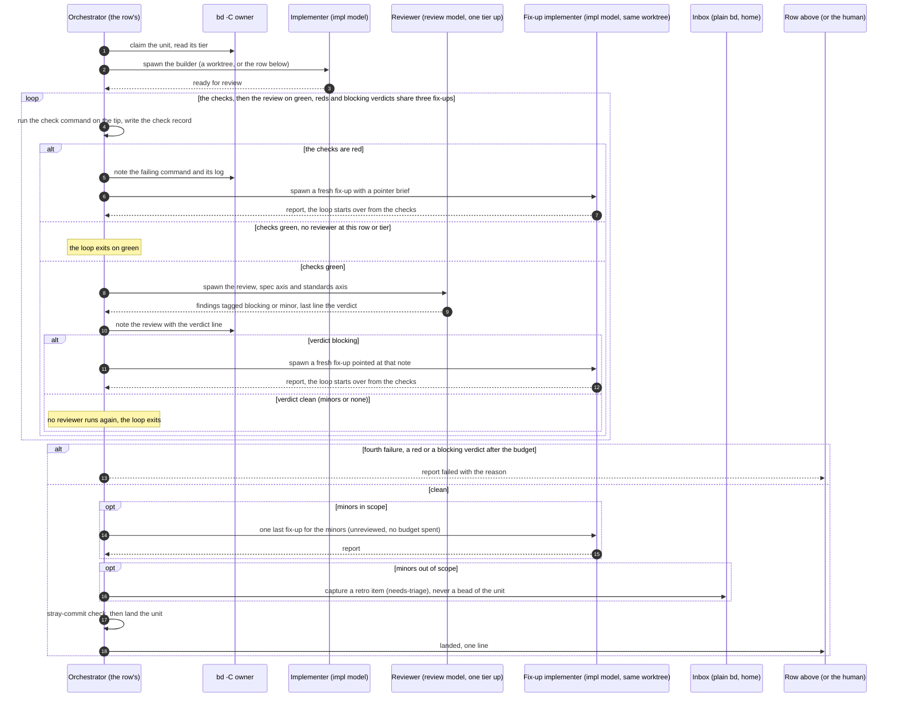

# Sequence diagram

How a feature is implemented, drawn once: the loop every row runs. This page explains and
decides nothing. The rules are in `docs/agents/orchestration.md`: the loop and its table
(The loop), the two scoping rules (Scoping rules), the six trust rules (Trust rules), the
check gate and the review verdict (Review) and the frontier (Frontier). The why is in
`docs/adr/0001-two-stage-review.md`, ADR 0006 and ADR 0011. When the diagram and those
texts disagree, the texts win and the diagram is the bug. Bold terms are defined in
`GLOSSARY.md`.

## The loop

The ticket, the story and the epic are one loop at three rows. The diagram draws the row
in general, with `O` the row's orchestrator and the unit a ticket, a story or an epic. The
table in the model doc gives each row its parameters, and they are the words in the
diagram's notes.

| Parameter | Ticket row | Story row | Epic row |
|---|---|---|---|
| Orchestrator | ticket orchestrator | story orchestrator | epic orchestrator |
| Builds | one implementer in a worktree | ticket orchestrators in parallel over the frontier | story orchestrators in parallel over the frontier |
| Checks | the check command | the check command | the check command as the forge runs it |
| Reviewer | both axes, at the ticket's review model, none at `low` | both axes, at the review model of the story's max tier | the spec axis only, at the review model of the epic's max tier |
| Lands by | merge onto the integration branch | push, the PR staying a draft | the PR marked ready, the human merges |
| Exits when | the checks green on the tip the review called clean | the checks green on the tip the review called clean | the checks green on the tip the review called clean |
| Budget | three fix-ups | three fix-ups | three per story |

