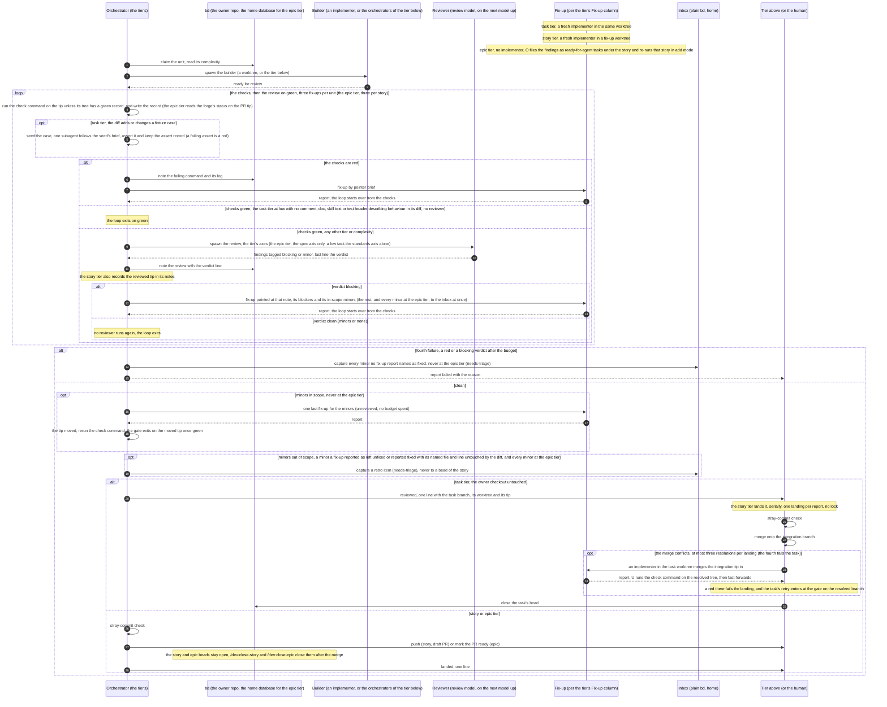

# Sequence diagram

How a feature is implemented, drawn once: the loop every tier runs. This page explains and
decides nothing. The rules are in `references/orchestration.md`: the loop and its table
(The loop), the two scoping rules (Scoping rules), the six trust rules (Trust rules), the
tier gates and the review verdict (Review) and the frontier (Frontier). The why is in
`docs/adr/0014-one-loop-at-three-rows.md`, ADR 0006 and ADR 0011. When the diagram and those
texts disagree, the texts win and the diagram is the bug. Bold terms are defined in
`GLOSSARY.md`.

## The loop

The task, the story and the epic are one loop at three tiers. The diagram draws the tier
in general, with `O` the tier's orchestrator and the unit a task, a story or an epic. Each
tier's parameters are the orchestration doc's table (`references/orchestration.md`, The loop): the
Fix-up column is where the tiers differ most, and the diagram draws all three of its cases.

